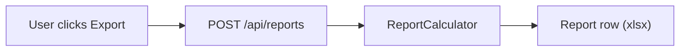

# Clear PR description

Goal: a reviewer understands the PR in two minutes. English, short sentences, no filler. Diagrams over paragraphs. No AI attribution line (see `workflow` rule 1).

## Template

Keep these sections, in this order. Drop a section only where noted.

````markdown
## Purpose
<1-2 sentences: the problem and what this PR does about it. Link the issue/intent: "Bolt 2/3 of intent #67, stacked on #246".>

## What it touches
- `backend/...`: <one line>
- `frontend/...`: <one line>
- DB: <migration name, or "no schema change">
- Docs/config: <only if any>

## Idea and implementation
<The design in a few lines, then the diagram(s).>



<Why this way, only if not obvious. Alternatives rejected in one line each.>

## Risks
- <What could break, who is affected, how to roll back. "None known" only if you checked.>

## Things to check
- [ ] <something not verified yet>
- [ ] <something not verified yet>

## Screenshots
<Drop this section when the PR has no visible change.>
````

## Rules per section

- **Purpose:** the why, not the file list. One issue link.
- **What it touches:** one bullet per area, path in backticks, a few words each. Mention migrations, new endpoints, new config.
- **Idea and implementation:**
  - Pick the diagram that fits: `flowchart` for flow or architecture, `sequenceDiagram` for calls between parts over time, `erDiagram` for data model changes, `stateDiagram-v2` for status changes. One to three diagrams per PR, each with at most ~10 nodes.
  - Label edges when the meaning is not obvious. Quote node text that has spaces or symbols: `A["POST /api/x (auth)"]`. Plain Mermaid, no custom styling, so it renders in light and dark mode.
  - Under each diagram, at most 3 lines: the key decision and why. No line-by-line walkthrough.
  - For a refactor, show before and after.
- **Risks:** concrete (data loss, wrong totals, breaking an API, slow query, migration order). Add the mitigation or rollback in the same bullet.
- **Things to check:** only what is **not yet checked**. Write what to check and how, so a reviewer can do it. Do not list things you have already verified here (they go in the PR's tested notes as a result, see below).

## Keep "Things to check" up to date

The list is live. Whenever you verify an item (test run, build, browser flow, review, manual check):

1. Read the current body (the `--attach` upload and the reviewer may have changed it): `gh pr view <n> --json body --jq .body > body.md` (use the scratchpad).
2. Edit only the list in `body.md`:
   - passed: `- [x] <item>: <result in a few words>`
   - failed: keep `- [ ]` and add `FAILED: <first error line>`
   - new thing to check discovered: add `- [ ] ...`
3. Publish: `gh pr edit <n> --body-file body.md`.

Do this right after each verification step, not once at the end. When everything is checked, the list is all `[x]`; leave it in place as the record.

## Screenshots

- Only for visible changes. Real screens of the page, not a cropped component or a mock-up. Desktop (800 px viewport) and mobile (375 px preset). Hide dev overlays first (e.g. `nextjs-portal`).
- Save the files, then attach them to the PR:
  ```bash
  gh pr edit <n> --attach './desktop.png#Desktop: <what it shows>' --attach './mobile.png#Mobile: <what it shows>'
  ```
  Put `` in the body under "Screenshots"; `gh` rewrites it to the uploaded image. No screenshots branch.
- Re-attach after a visible change, and read the body first (step 1 above) so you do not overwrite edits.

## Checklist before publishing

1. Every section present, in order.
2. The diagram renders (check the PR page, not only the source).
3. Nothing in "Things to check" that you already verified.
4. Body is English and has no attribution line.
