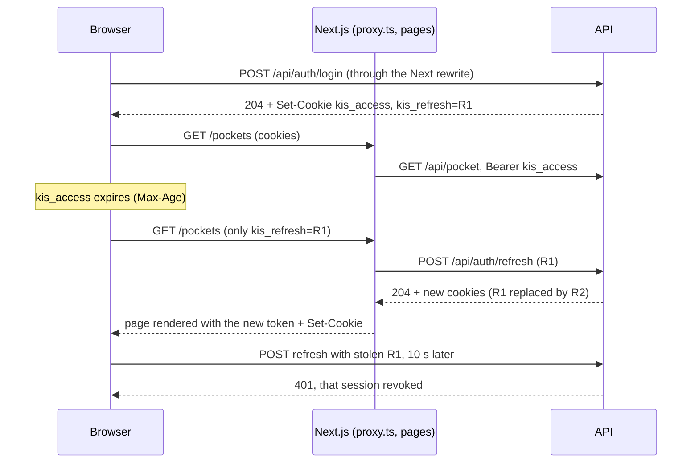

# Accounts: login, access token, refresh token

Login gives the browser two tokens with different jobs. Both are HttpOnly cookies, so page scripts never see them. This follows the Next.js authentication guide.

| | Access token | Refresh token |
|---|---|---|
| What it is | Signed JWT (`TokenService`) | 32 random bytes, hex encoded |
| Cookie | `kis_access` | `kis_refresh` |
| Lifetime | `JwtSettings:ExpiryMinutes`. The cookie's `Max-Age` is 30 s shorter, so the browser drops it before the API would reject it | `JwtSettings:RefreshExpiryDays` (14), renewed on each refresh |
| What the server stores | Nothing: the signature proves it | SHA-256 hash in `identity.RefreshTokens` |
| Can be revoked | Yes: its `sid` claim must name an active session on every request (see Sessions) | Yes |

Both cookies have `HttpOnly`, `SameSite=Lax` and `Path=/`, and `Secure` when the request is HTTPS. They use `Max-Age` rather than `Expires`: the browser counts `Max-Age` with its own clock, so a wrong client clock doesn't matter. `TokenService.AuthCookieOptions` builds the options for both.

The JWT is read from the `Authorization: Bearer` header when there is one; this is how server components and Swagger send it. Otherwise it's read from the `kis_access` cookie (`JwtBearerEvents.OnMessageReceived` in `AuthSetup`).

## Endpoints (`/api/auth`)

- `POST login`:
  - checks the password, creates a new session (new `SessionId`), sets both cookies, and returns 204;
  - the user's other sessions stay: several browsers can be signed in at once;
  - 5 wrong passwords lock the account for 15 minutes (`IdentitySetup`). While locked, every attempt, even with the right password, gets **423 Locked** with `LockoutResponse { retryAfterSeconds }`. Seconds rather than an end timestamp, so the client's countdown doesn't depend on its clock. This tells a caller the username exists, but only after 5 failed tries on it; an unknown username stays a plain 401.
- `POST refresh`: no body; reads `kis_refresh`.
  - **Valid**: in one transaction, the row is revoked and points at its replacement (`ReplacedByHash`), and the new row is inserted. Both cookies are set again.
  - **Unknown, expired or revoked** (for example after logout): 401, and both cookies are cleared.
  - **Rotated less than 10 s ago, and its successor is still active** (grace period): a new row and cookies are issued. Parallel requests that found the same expired token (prefetches, several tabs) don't log the user out.
  - **Rotated earlier** (reuse): 401 and **that session is revoked** (all rows of its `SessionId`). Only the attacker or the real user can hold the newer token, and the server can't tell which, so both have to log in again. The user's other sessions stay.
- `POST logout`: revokes the whole session of the cookie's row and clears both cookies. Always 204, even without a cookie.
- Login and a valid refresh also delete the user's expired rows. Revoked rows stay until they expire: a reused token is only caught while its row exists.
- `GET me`: the signed-in user (`UserResponse`: `id`, `userName`, `email`, `pictureVersion`), read from the JWT's `sub` claim. `pictureVersion` is the ticks of the picture's last update, null without a picture. Returns 401 when that user no longer exists.

## Sessions

- Each login creates a `SessionId` (Guid). Every refresh row of that login carries it, and rotation copies it to the new row. The access token has it in the `sid` claim.
- `JwtBearerEvents.OnTokenValidated` (`AuthSetup`) rejects a token whose `sid` is missing or has no active row (`RefreshToken.IsSessionActiveAsync`). A revoked session therefore stops on its next API request, not when the access token expires.
- Trade-off: the JWT is no longer stateless. Every authenticated request runs one indexed query on `RefreshTokens.SessionId`.
- Logout ends the whole session. A replayed token ends that session only. Change password and reset password end every session of the user.
- Tokens issued before this change have no `sid`: they get one 401, and the user logs in again.

## Profile picture (`/api/account/picture`)

- `PUT`: multipart form with one `file`. At most 1 MB; the type comes from the file's first bytes (PNG, JPEG or WebP), not from the client's Content-Type. Replaces the previous picture. 400 with `ValidationProblemDetails` (`file`) otherwise.
- `GET`: the caller's picture, or 404. Cached for a year (`private, immutable`): the UI adds `?v=<pictureVersion>`, so a new upload gets a new URL.
- `DELETE`: removes it. Always 204.
- Stored as bytes in `ProfilePictures` (one row per user, deleted with the user). The UI shrinks the image to 256×256 before uploading, so rows stay small.

## Email confirmation

- `POST register` queues a confirmation email (`NotificationManager`, email channel). The background dispatcher sends it; the body is cleared once sent, since it holds the link.
- Link: `{Frontend:BaseUrl}/confirm-email?userId=...&token=...`. The token is Identity's email confirmation token, Base64Url-encoded for the query string. Identity's default lifetime is 1 day.
- `POST confirm-email` `{ userId, token }`: 204 when confirmed, 400 for a bad or expired link. Idempotent: an already confirmed user gets 204.
- `POST login` with the right password but an unconfirmed email: **403** `{ "code": "email_not_confirmed" }`. A wrong password stays 401, and wrong passwords count toward the lockout. An expired password keeps its bare 403.
- `POST resend-confirmation` `{ username }`: always 204, so it does not reveal whether the account exists. Sends at most one email per minute per user.
- Migration `ConfirmExistingUsersEmail` marks existing accounts confirmed, so they are not locked out.
- `Frontend:BaseUrl` is required (production: `Frontend__BaseUrl`, the public web address); the API refuses to start without an absolute URL.
- The check is done in `Login` after the password, not with Identity's `SignIn.RequireConfirmedEmail`: that option rejects before the password is checked, which would bypass lockout counting.

## Forgot password

- `POST forgot-password` `{ email }`: always 204, so it does not reveal whether the email is registered. Sends at most one email per minute per user.
- Link: `{Frontend:BaseUrl}/reset-password?userId=...&token=...`. The token is Identity's password reset token, Base64Url-encoded. Lifetime is 1 day. It is single use: a reset changes the security stamp, so the same token fails after it is used.
- `POST reset-password` `{ userId, token, newPassword }`:
  - 204 when the password is reset;
  - 400 with `"Invalid or expired reset link."` for a bad or expired link;
  - 400 `ValidationProblemDetails` keyed `newPassword` when the password breaks the rules (the token is not used up).
- On success:
  - restarts the password expiration clock (`PasswordChangedAt`);
  - revokes every session of the user, so they stop on their next request;
  - lifts a lockout and confirms the email, since the reset proves the user owns the inbox (saved in the same write as the password);
  - rejects the current password as the new one (400 `newPassword`), checked only after the token is verified so it is no password oracle;
  - does not sign the user in: the user logs in with the new password.

## Which endpoints need a token

All of them, through a fallback policy in `AuthSetup`: any endpoint without authorization metadata requires a signed-in user, so new controllers are protected by default.

Only `register`, `login`, `refresh`, `logout`, `change-password`, `confirm-email`, `resend-confirmation`, `forgot-password` and `reset-password` are `[AllowAnonymous]`. `refresh` and `logout` have to be anonymous, because they run when the access token may already have expired; the cookie identifies the session there. `AuthorizationCoverageTests` fails if any other action allows anonymous access.

## Who owns what

- Pockets and category rules have an owner (`UserId`, a foreign key to `identity.AspNetUsers`, `Restrict` on delete). Transactions are owned through their pocket.
- Controllers read the caller's id with `User.GetUserId()` (the JWT `sub`) and pass it to every model method. Each query filters by it.
- Another user's row answers exactly like a missing one, with 404. Lists and analytics only contain the caller's data. Creating a row sets the owner from the token: `UserId` is `[JsonIgnore]`, so the body can't set it.
- Import sessions are bound to the user who uploaded the file.
- `UserId` is required (`NOT NULL`). Rows created before ownership existed were assigned to their owner by a one-off backfill endpoint, which has since been removed.

## In the UI

The browser only talks to the Next app. `next.config.ts` rewrites `/api/*` to `API_BASE_URL`, so the cookies are first-party and the API needs no CORS.

- **Login page**: a 423 shows `LockoutNotice` with a live countdown (`m:ss`) instead of the error toast. It goes away when the time runs out or the username changes. `fetchWrapper` keeps the JSON body of failed responses in `errorData`; `login()` reads the lockout from it and `register()` the taken fields of a 409.
- **`frontend/proxy.ts`** is the optimistic check, and it never calls the API when `kis_access` is present.
  - `/login` is public.
  - With `kis_access`, the request goes on.
  - With only `kis_refresh`, the proxy refreshes, at most once per token per server process. It writes the new cookies to the current request, so this render already uses them, and to the response, so the browser keeps them.
  - With neither cookie, or when the API rejects the refresh token (401), the user is redirected to `/login` and both cookies are cleared.
  - When the API is down or fails (network error, 5xx), the cookies are kept and the request goes on. The session survives the outage, and the page shows its load errors.
- **Logout (`NavUser`)** calls the `logout` Server Function (`frontend/lib/actions/auth.ts`). Only the server can expire HttpOnly cookies. It sends the refresh cookie to the API to revoke the session, then clears both cookies even if that call fails, so the next visit needs a new login. It runs while the cookies still exist, so `proxy.ts` lets the call through.
- **`frontend/lib/fetchWrapper.ts`** behaves differently on each side:
  - **On the server**, it sends `kis_access` as `Bearer`, and a 401 becomes `redirect("/login")`. That makes every server-side data load the real guard.
  - **In the browser**, it calls relative `/api/...`, and the cookies go along automatically. A 401 triggers one refresh (`refreshOnce`, never two at a time), then one retry. If the refresh fails, the user is sent to `/login`.
- **`frontend/lib/dal.ts`**: `getCurrentUser()` (React `cache`, so once per render) loads `/me`. The `(app)` layout passes the result to `UserIdentityProvider` (`frontend/stores/userIdentity`). Client components read it, and the `logout` action, with `useUserIdentityContext()`.

## Known limits

- The proxy trusts a present `kis_access` without checking it; the API enforces the session on the next request, so a revoked session ends with a 401 there.
- Each grace-period refresh leaves one extra active refresh row for the session, until it expires. Extra rows share the `SessionId`, so they never count as another session.
- Through the rewrite, the API sees HTTP, so in production behind TLS `Secure` would be off. That needs `UseForwardedHeaders` when we deploy.
- The proxy dedupes refreshes within one server process. With several instances, only the grace period protects parallel refreshes.