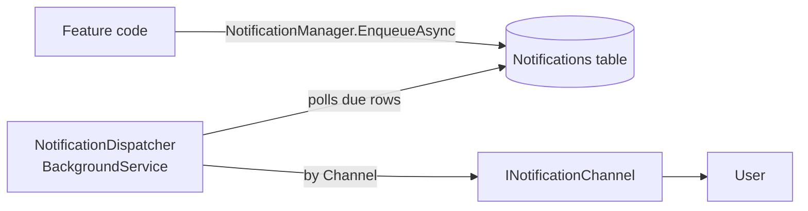

# Notifications

Features notify a user through one entry point, `NotificationManager`, without knowing how the message is delivered.
Delivery happens in the background, so a slow or failing channel never blocks a request.

## How it works

1. A feature calls `NotificationManager.EnqueueAsync(userId, channel, recipient, subject, body)`.
   It validates the channel and recipient and stores a `Pending` row in `Notifications` (an outbox). Nothing is sent yet:
   the message goes out on the dispatcher's next poll, so up to `PollIntervalSeconds` later.
2. `NotificationDispatcher` wakes every `PollIntervalSeconds`, loads up to `BatchSize` pending rows whose `NextAttemptAt` has passed,
   and hands each one to the `INotificationChannel` registered for its `Channel`.
3. Success marks the row `Sent` and clears its body (bodies can hold live tokens, such as confirmation links).
4. A failure increments `Attempts`, stores the error in `LastError`, and retries after `RetryBaseSeconds * 2^(Attempts - 1)`.
   After `MaxAttempts` the row becomes `Failed` and is not retried.
   A row whose channel has no registered implementation fails at once.

Because the queue lives in Postgres, notifications survive an API restart.

## Statuses

| Status | Meaning |
|--------|---------|
| `Pending` | Waiting for its first or next attempt |
| `Sent` | Delivered by its channel |
| `Failed` | Gave up after `MaxAttempts` (or no channel exists) |

## Settings

`appsettings.json`, section `Notifications`:

| Key | Default | Meaning |
|-----|---------|---------|
| `PollIntervalSeconds` | 10 | How often the dispatcher looks for due rows |
| `BatchSize` | 20 | Rows handled per poll |
| `MaxAttempts` | 5 | Attempts before a row is `Failed` |
| `RetryBaseSeconds` | 30 | First retry delay; doubles on each attempt |
| `InAppRetentionDays` | 30 | In-app notifications older than this are deleted, read or not |

## Adding a channel

1. Add a value to `NotificationChannelType` (never 0).
2. Implement `INotificationChannel` in `models/notifications/channels/`. Throw on failure; the dispatcher handles retries.
3. Register it in `NotificationSetup.AddKeepItSimpleNotifications` with `services.AddSingleton<INotificationChannel, YourChannel>()`.
4. Add a typed method on `NotificationManager` for each message the features send.

Channels are singletons. A channel that needs the database or other scoped services goes through `KeepItSimpleContext`, not constructor injection.

## Email channel

- Sent over SMTP with MailKit (`EmailChannel`). Messages are HTML.
- Settings live in the `Email` section:

| Key | Default | Meaning |
|-----|---------|---------|
| `Host` | `""` | SMTP host. Empty means every email fails with `Email:Host is not configured.` |
| `Port` | 587 | SMTP port |
| `UseSsl` | false | `true` uses SSL on connect; `false` uses STARTTLS when available |
| `Username` | `""` | SMTP login. Empty means no authentication |
| `Password` | `""` | SMTP password. Keep it out of committed files |
| `FromAddress` | `no-reply@keepitsimple.local` | Sender address |
| `FromName` | `KeepItSimple` | Sender display name |

- Development: the API sends to Mailpit (docker compose service `mailpit`, SMTP `localhost:1025`).
  Open the inbox at http://localhost:8025. No real email leaves the machine.
- Production: set `Email__Host`, `Email__Port`, `Email__UseSsl`, `Email__Username`, `Email__Password` as environment variables. Never commit secrets.
- Templates live in `EmailTemplates` (`helpers/`). Names and links are HTML-encoded.
- Features call `NotificationManager.EnqueueEmailConfirmationAsync` and `NotificationManager.EnqueuePasswordForgotAsync`.
- Settings classes (`NotificationSettings`, `EmailSettings`) live in `settings/`.

## In-app channel

- `InAppChannel` stores each notification as a row in `InAppNotifications` (title, body, `ReadAt`). Recipient is the user id.
- `NotificationManager.EnqueueInAppAsync(userId, title, body)` queues one; the dispatcher turns it into a row on its next poll.
- Endpoints (authenticated, own rows only):
  - `GET /api/notifications?read=false|true` lists the newest 50 unread or read rows.
  - `GET /api/notifications/unread-summary` returns `{ count, latestId }`, for polling.
  - `POST /api/notifications/{id}/read` marks one row read (404 if it is not the caller's).
- Read rows stay. Rows older than `Notifications:InAppRetentionDays` (default 30) are deleted, checked hourly by `NotificationDispatcher`.

## Limits

- Delivery is at least once: if the channel sends but marking the row `Sent` fails, the row is retried and sent again.
- The dispatcher assumes a single API instance. With several instances, rows must be claimed with `FOR UPDATE SKIP LOCKED` to avoid double sends.
- The dispatcher starts with `app.Run()` and relies on `KeepItSimpleContext.InitContext` having run before it.
