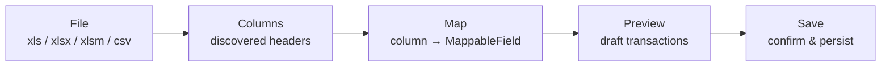
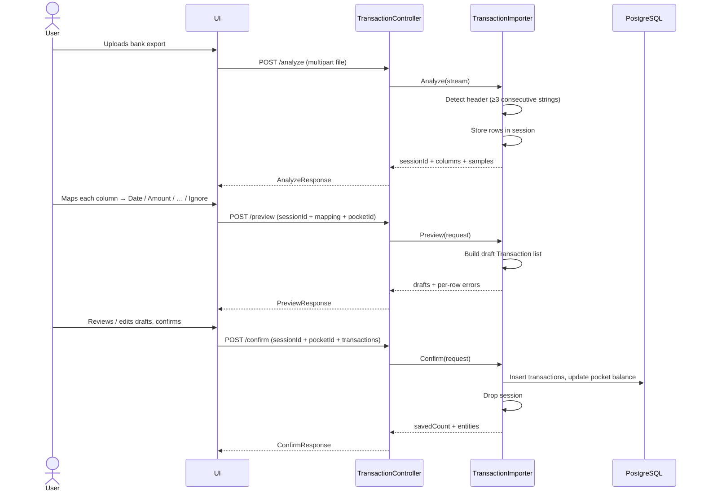
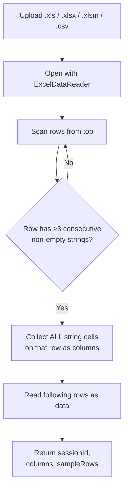
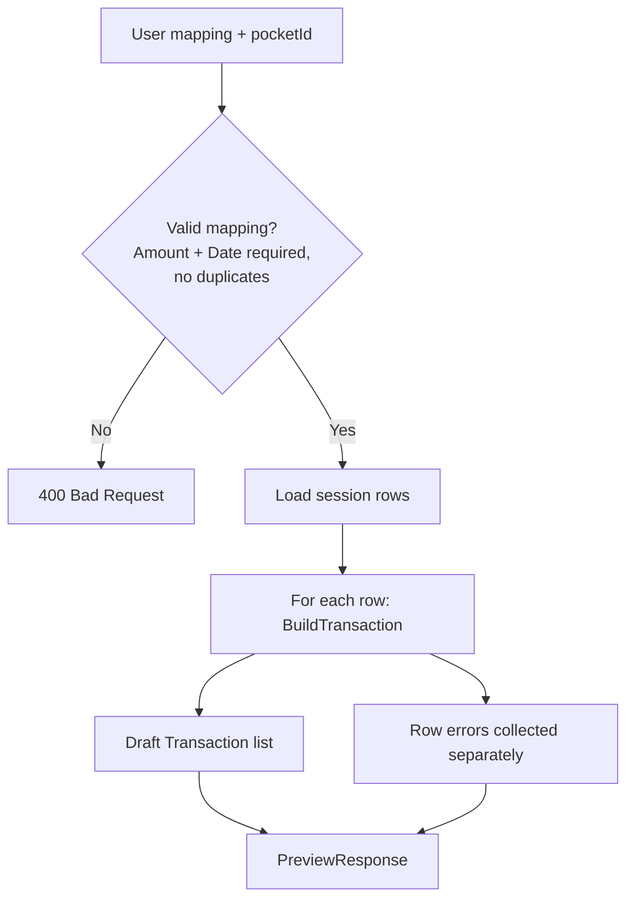
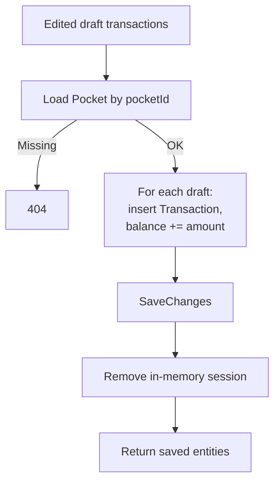
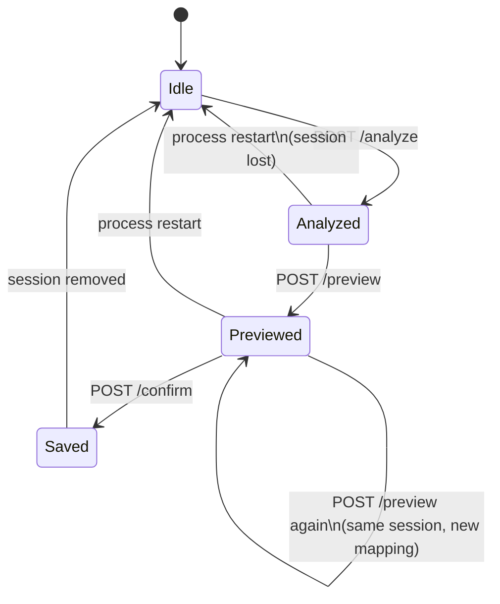

# TransactionImportFlow

End-to-end conversation between UI and API: **file → columns → map → save**.

**Importer details:** [TransactionImportUtil.md](./TransactionImportUtil.md)  
**Category rules (applied at preview):** [CategoryRules.md](./CategoryRules.md)  
**Backend overview:** [../README.md](../README.md)

---

## Big picture

The user never dumps raw Excel into the database. Each step is an explicit API round-trip so the UI can show progress, let the user choose mappings, and review drafts before write.

---

## Sequence (UI ↔ API)

---

## Step by step

The upload session belongs to the user who sent the file. `pocketId` must be one of the caller's pockets: preview and confirm answer 404 for someone else's session or pocket.

### 1. File → columns (`analyze`)

**UI responsibility:** render each discovered column and let the user pick a `MappableField` (`Ignore`, `Description`, `Amount`, `Date`, `Category`). Sample rows help disambiguate labels like `"Data di erogazione"`.

| Excel column | User maps to |
|--------------|--------------|
| Data di erogazione | `Date` |
| Causale | `Description` |
| Importo | `Amount` |
| Valuta | `Ignore` |

---

### 2. Columns → map → drafts (`preview`)

**UI responsibility:** show the draft table, surface row errors, allow edits (amount sign, category, drop a line) before confirm. Draft categories already include user **category rules** (after column aliases).

Nothing is written to the database yet.

---

### 3. Map → save (`confirm`)

**UI responsibility:** call confirm only after explicit user confirmation; then refresh the transaction list / pocket balance from the normal CRUD APIs.

---

## State machine

---

## Endpoints cheat sheet

| Step | Method | Path | Body |
|------|--------|------|------|
| File → columns | `POST` | `/api/transactions/import/analyze` | `multipart`: `file` |
| Columns → map | `POST` | `/api/transactions/import/preview` | JSON: `sessionId`, `pocketId`, `mapping`, `defaultCategory?` |
| Map → save | `POST` | `/api/transactions/import/confirm` | JSON: `sessionId`, `pocketId`, `transactions` |

`mapping[].targetField` is a `MappableField` enum, serialized as a string (`"Date"`, `"Amount"`, …).

---

## Minimal happy path

1. User uploads `estratto.xlsx`
2. API returns columns `Data`, `Descrizione`, `Importo`, `Saldo`
3. User maps Data→`Date`, Descrizione→`Description`, Importo→`Amount`, Saldo→`Ignore`
4. API returns N draft transactions (and maybe a few row errors)
5. User confirms → N rows in `Transactions`, pocket balance updated

---

## Saved column mappings

A user can save a column mapping (`Columns`: header → `MappableField`) and reuse it on later files with the same layout.

### Endpoints

| Method | Path | Notes |
|--------|------|-------|
| `GET` | `/api/import-mappings` | All of the caller's mappings, ordered by name |
| `GET` | `/api/import-mappings/{id}` | `404` when missing or owned by someone else |
| `POST` | `/api/import-mappings` | Body without `id`. `400` on validation, `409` on name clash or the limit; errors are `{ "message": "..." }` |
| `PUT` | `/api/import-mappings/{id}` | Same errors as `POST`. `404` when missing |
| `DELETE` | `/api/import-mappings/{id}` | `204` or `404` |

### Analyze suggests a mapping

`POST /api/transactions/import/analyze` returns `suggestedMappingId` (int or `null`) next to `columns` and `sampleRows`. The UI can preselect that mapping; the user still confirms it on the preview step.

### Match rule (`ImportMapping.FindBestMatch`)

A saved mapping is a candidate when every non-`Ignore` column header occurs exactly once in the file. Headers compare after trim and lower-casing.

Among candidates, the first rule that separates them wins:

1. Exact header set: the saved headers (all columns, `Ignore` included) equal the file headers.
2. More non-`Ignore` columns.
3. Later `UpdatedAt`.

Consequences:

- A mapped header that was renamed or removed in the file means no match.
- An `Ignore` column that is missing from the file does not block a match. It only lowers the exact-set rank.
- A mapped header that appears twice in the file means no match.

### Validation and limits

- Name: required, trimmed, up to 100 characters. Unique per user, case-insensitive.
- Columns: 1 to 200. Headers required and unique (trimmed, case-insensitive).
- Exactly one `Amount` and one `Date` column are mapped. Every other field is mapped at most once.
- Up to 50 mappings per user.
- Mappings belong to the user. Another user's id behaves like a missing one.
